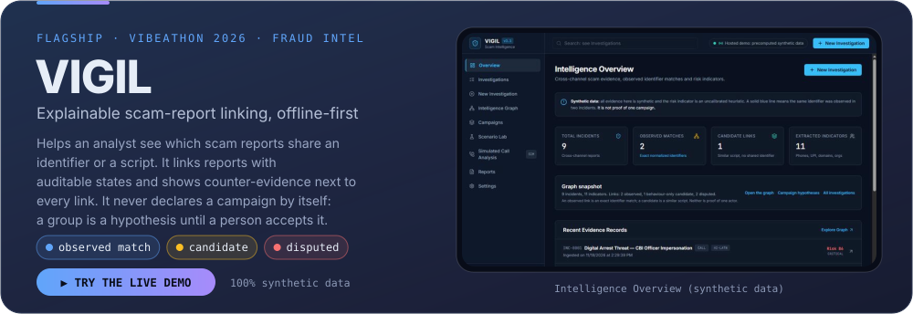
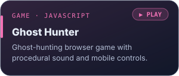
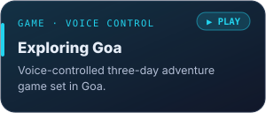
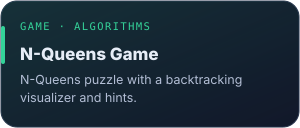

 

 

  

  

  
  
  
  

 

  
  
  

 

  

  

 

  Looking for an AI/ML intern, a research collaborator or a hackathon teammate? 
  Email me at <a href="mailto:shriyapatil1966@gmail.com"><b>shriyapatil1966@gmail.com</b></a> or open an issue on any repo above.

