 

 

  

  
  
  
  
  
  

 

| Project | What it is | |
|:--|:--|:--|
| 🧭 **CareerPilot AI** | Flask app that uses Gemini to score a PDF or DOCX resume against a target role, with skill gaps and practice questions | [code](https://github.com/ShriyaP1966/CareerPilot-AI) |
| 🔍 **ML Fraud Detection** | Comparative study of Logistic Regression, KNN, Linear SVM and Decision Trees on two imbalanced fraud datasets | [code](https://github.com/ShriyaP1966/ML-Fraud-Detection-Optimization) |
| ⛓️ **Sepolia Sentiment API** | AI × Blockchain experiment | [code](https://github.com/ShriyaP1966/sepolia-sentiment-api) |
| 👻 **Ghost Hunter** | Canvas arcade game in plain JavaScript with procedural sound and mobile controls | [code](https://github.com/ShriyaP1966/GhostHunter-Game) · [play](https://shriyap1966.github.io/GhostHunter-Game/) |
| 🌴 **Exploring Goa** | Browser game built for a Hacker House Goa task | [code](https://github.com/ShriyaP1966/ExploringGOA-game) · [play](https://exploring-goa-game.vercel.app/) |
| ♛ **N-Queens Game** | Interactive N-Queens puzzle | [code](https://github.com/ShriyaP1966/NQueen-Game) |
| ❓ **QuizApp** | Quiz application | [code](https://github.com/ShriyaP1966/QuizApp) |

 

  

  

 

  Looking for an AI/ML intern, a research collaborator or a hackathon teammate? 
  Email me at <a href="mailto:shriyapatil1966@gmail.com"><b>shriyapatil1966@gmail.com</b></a> or open an issue on any repo above.

